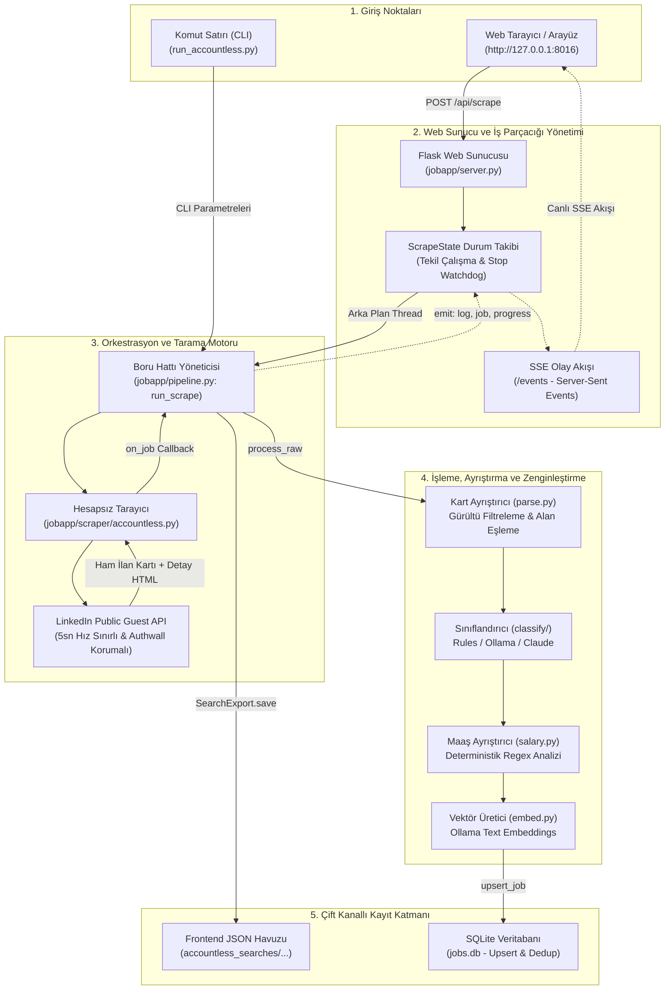
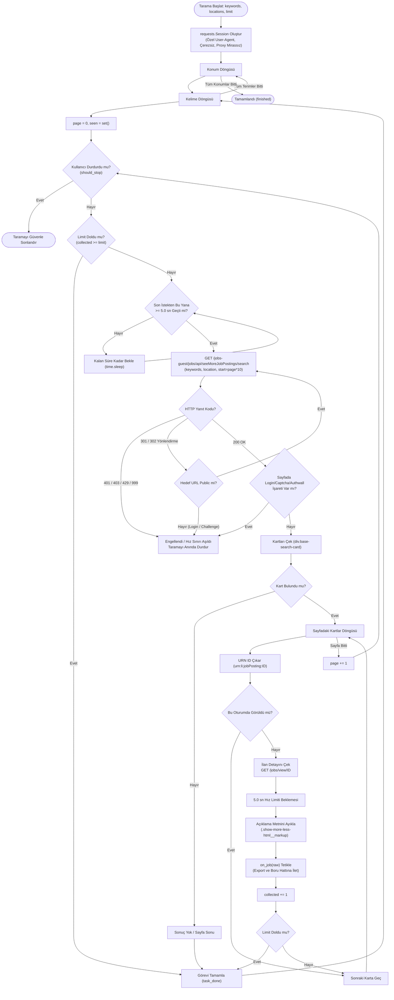
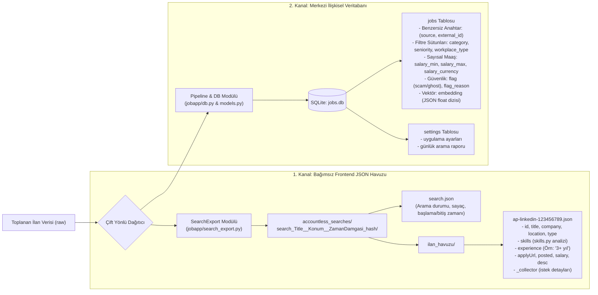
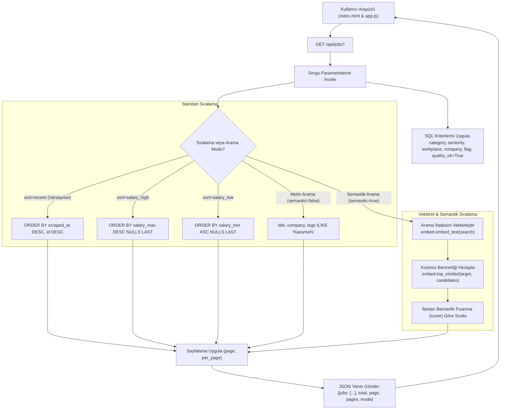

# Linko Scrapper Light

### Üç katmanlı görev kuyruğu

Tek toplayıcı, hazır işleri şu sırayla çalıştırır:

1. **Manuel görevler:** Kullanıcının başlattığı aramalar, analizler, alan düzeltmeleri,
   “Devam et” ve “Şimdi çalıştır” istekleri. Düzenleme aşamasındaki taslaklar otomatik başlamaz.
2. **Eksik/hatalı ilanlar:** Açıklaması ertelenmiş veya eksik ilanlar ve boş kaynak alanları.
   Önce alınmış veri kaydedilir, ardından yeni detay istenir.
3. **Rutin taramalar:** Kayıtlı şehir × meslek listeleri ve zamanlanmış tekrarlar.

Rutin şehir havuzunda 47 şehir bulunur. İstanbul ilk sıradadır, kritik önceliklidir ve ilan hedefi limitsizdir; diğer şehirlerin varsayılan hedefi arama başına 50 ilandır. Şehir ve hedef listesi İş alarmları ekranında ve `GET /api/routine-cities` uç noktasında görüntülenir. Meslek listesi henüz eklenmediği için bu katalog otomatik şehir × meslek görevleri oluşturmaz.

Daha yüksek öncelikli hazır iş geldiğinde alt katman güvenli noktada sırayı bırakır;
devam noktası ve elde edilen ilanlar korunur. Kullanıcının duraklattığı işler otomatik başlamaz.
Kaynak beklerken yeni görev eklenebilir; ağ isteği gerektiren işler bekleme dolunca başlar.
Geçici hatalarda görev bazında artan bekleme uygulanır. 404/410 ile kaldırılmış ilanlar
ayrı gösterilir. Tek hatalı ilan diğer hazır işleri engellemez; ortak hız sınırı korunur.

İlan detayından yeniden alınacak alanlar seçilebilir. `POST /api/jobs/<id>/repair`,
`fields` listesinde `description`, `title`, `company`, `location`, `tags`, `experience_years`,
`workplace_type`, `category`, `seniority` kabul eder. Türetilen alanlar, açıklama mevcutsa
kaynağa gitmeden işlenir. `fetch-detail` ucu da manuel kuyruğa ekler ve 202 döner.
Maaş gibi isteğe bağlı alanlar zorunlu eksik sayılmaz; bulunamayan bilgiler uydurulmaz.

Görev kaynağı ve önceliği mevcut `search_runs.options` alanında, alan tamamlama işleri
yeni `repair_tasks` tablosunda saklanır. Mevcut veriler korunur; yeniden başlatmada işler
devam eder. Veritabanı ile JSON havuzları birlikte güncellenir. Önce kartları kaydeden akış
ve açıklama geldikten sonra seçili analiz yöntemiyle işleme davranışı korunur.

`/api/scrape/status` ve `/api/v1/status`, `queue_layers` ile üç katmanın sayaçlarını,
`completion_queue` ile tamamlama durumunu verir. `/api/completion-queue?status=retry`
alanları, hata nedenini ve sonraki deneme zamanını gösterir. Ayrı detay worker'ı yerine
tek supervisor bütün toplama işlerini sıralar.

Otomatik tamamlama katmanı kuyruk ekranından duraklatılıp devam ettirilebilir;
`POST /api/completion-queue/pause` ve `/resume` aynı işlemi API üzerinden yapar.
“Tüm kuyruğu iptal et” otomatik tamamlamayı da duraklatır. Yeni manuel alan istekleri
üst katmanda çalışmaya devam edebilir; otomatik katman ancak açıkça devam ettirilince açılır.

> **Şifreler ve anahtarlar nerede?** Ana dizindeki `SIFRELER.txt` dosyasında: arayüz
> kullanıcı/şifresi, servis API anahtarı, Groq API anahtarı. Dosya `.gitignore` içinde
> olduğu için GitHub'a gitmez; yalnızca bu bilgisayarda durur, yedeğini kendin al.
> Sunucudaki kopya: `/root/linko-ui-credentials`. Canlı site: https://job.ai-org.online
> (kurulum: `website_kurulum.md`).

## Güncel arayüz ve kullanım

Arayüz tamamen Türkçedir. Ana ekranda arama, sıralama ve kart/liste görünümü; sol panelde çok katmanlı filtreler bulunur. Seçili filtreler üstte kaldırılabilir etiketlerle gösterilir. Son form değerleri, taslak kuyruk ve görünüm tarayıcıda saklanır; filtreler URL üzerinden de korunur. Tarayıcının geri/ileri düğmeleri filtre geçmişini takip eder.

- **Yeni tarama:** Her satıra bir unvan yazın, konum ve hedef seçin. Farklı konum/limitlerle görevler ekleyip sıralayabilirsiniz. Yapay zekâ seçenekleri gelişmiş ayarlardadır. Kayıtlı ilanları yeniden işleme ayrı bir bölümdedir.
- **Kalıcı kuyruk:** Duraklatma, devam etme ve iptal etme ayrıdır. Sunucu kapanırsa yarım kalan çalışma devam edilebilir durumda açılır. Tamamlanan görevler atlanır; yarım sayfa görülmüş ilan kimlikleriyle tekrar kontrol edilir. Kaynak sonuçları değişebileceği için bu bir kaynak tarafı snapshot garantisi değildir.
- **Geçmiş:** Yeniden tarama eski havuzu silmez, yeni bir çalışma oluşturur. Seçili görevlerin konumları ve limitleri korunur. “İlanları gör” ve “Çalışmanın ilanları” ilgili arama/çalışmayla ilişkili tüm ilanları açar. “İlk kez eklenenler” ayrı bir seçenektir. Eski kayıtların ilk ekleyen araması, mevcut zaman bilgileri yeterliyse yeniden kurulur; eksik geçmiş için kesin bilgi üretilemez.
- **Filtreler:** Kategori, kıdem, konum, şirket, çalışma biçimi, yetenekler, deneyim, maaş, tarihler, kaynak, analiz yöntemi, arama ilişkisi, içerik durumu ve çöp kutusu birlikte kullanılabilir. Katmanlar VE; aynı katmandaki seçimler VEYA ile birleşir. Yetenekler için tümü/herhangi biri ve hariç tutma vardır. Maaş karşılaştırmasında para birimi ve dönem seçilmelidir; kur dönüşümü yapılmaz.
- **Detaylar:** Önceki/sonraki ilan, mevcut filtre ve sıralama içinde sayfa sınırlarını aşarak çalışır. Pencere kapanınca liste konumu korunur.
- **Geri alınabilir silme:** İlan veya arama geçmişi önce çöp kutusuna taşınır. Geri yükleme ve kalıcı silme ayrı işlemlerdir. Arama geçmişini silmek ortak ilanları silmez. Çöp kutusundaki ilan yeniden taramayla kendiliğinden görünür hale gelmez. İlanın silinme durumu JSON havuzlarına `_deletedAt` alanıyla yansır.
- **İşlem kayıtları:** Geçmişte her aramanın logları katman ve seviyeye göre incelenebilir. İstek kimliği, HTTP durumu, süre, dönen kartlar, çekilen/tekrar/başarısız/işlenmeyen ilanlar ve ilgili ilan kimlikleri kayıtlıdır. JSONL indirme ve eski metin loglarını açma desteklenir. Dönen kart sayısı, kaynağın toplam ilan sayısı değildir; yeniden denenen sayfalarda aynı kart tekrar sayılabilir.

### Veri ve geçiş

### Süreç kimlikleri ve ayrıntılı denetim

Kuyruğa eklenen görevler çalıştırılmadan önce de `/api/queue` üzerinden sunucuya kaydedilir. Süreç kimliği (`run_id`), görev/arama kimliği (`search_id`), her çalıştırma veya devam etmenin kimliği (`attempt_id`), HTTP istek kimliği (`request_id`) ve tekil log kayıt numarası ayrı ayrı izlenir. Kuyruk sıralaması/ayar değişiklikleri, çıkarılan görevler, kullanıcı işlemleri ve sunucu kesintisinden kurtarma olayları geçmişte korunur.

**Panel sekmesi:** İlanlar'ın sağındaki *Panel* sekmesi (telefonda Diğer menüsü) havuzun ve toplayıcının özetini gösterir: etkin ilan sayısı, günlük eklenme akışı, meslek/çalışma biçimi/kıdem/yetenek/şirket/konum dağılımları, ilan yaşı, maaş aralıkları, veri kalitesi, son tarama turları, eklenme saatleri ısı haritası ve kaynak/iş alarmı durumu. Veri tek uçtan (`GET /api/dashboard`, 20 sn önbellekli, yalnızca okur) gelir; satır ve kartlara tıklamak İlanlar'ı ilgili filtreyle açar, her grafiğin altında tablo görünümü vardır.

Geçmişteki **Süreç raporu / Neden az geldi?** düğmesi; kart ve ilan sayılarını, tekrarları, detay hatalarını, kayıt/kalite nedeniyle elenenleri, görünür/çöp kutusundaki kayıtları ve durma nedenlerini bir arada gösterir. Bulgular dayanaklarıyla ve uygulanabilir sonraki adımlarla sunulur. Eski süreçlerin kaydedilmemiş ayrıntıları tahmin edilmez. Tarama yanında eşleştirme ve yeniden analiz işleri de süreç kimliği ve devam noktası taşır.

`GET /api/runs/<id>/report?task_id=<görev>` raporu JSON verir; `download=1` ile indirilebilir. Loglar `kind`, `level`, `query`, `request_id`, `job_id`, `attempt_id` ve `task_id` ile süzülebilir. Ayrıştırma, sınıflandırma, eşleştirme ve veritabanı aşamaları; süre, gerçek analiz yöntemi, geri dönüş, hata türü ve hata iziyle kaydedilir. API anahtarları ve kimlik doğrulama değerleri loglarda gizlenir.

Başlatıcı, mevcut uygulama çalışıyorsa veritabanını yeniden başlatmadan tarayıcıyı mevcut adrese yönlendirir. Bu durumda `.bat` dosyası başarıyla kapanır; “Sunucu durduruldu” veya gereksiz devam istemi göstermez.

### Mevcut verinin yükseltilmesi

İlk yükseltmede mevcut SQLite veritabanı ve arama havuzu `jobapp/backup_before_ux_<tarih>/` altına yedeklenir. Yeni alanlar ve `search_runs`, `search_tasks`, `task_jobs`, `search_events` tabloları otomatik oluşturulur. Her çalışma `run_id`, her arama görevi `search_id` taşır. İlan yanıtlarında `search_ids`, `run_ids` ve `discoveries` alanları bulunur; tek ilanın farklı aramalardaki ilişkileri korunur. JSON ilanlarındaki `_collector.searchId` ve `_collector.runId` aynı kimlikleri taşır. Arama klasörlerinde `search.json`, `search.log` ve yeni taramalar için `events.jsonl` bulunur.

Web sunucusu aynı anda tek tarama/yeniden işleme çalıştırır. Üretimde mevcut `--workers 1` ayarını koruyun. Aynı veritabanını kullanan CLI ve web, kalıcı istek sırasını ve kaynak duraklatma durumunu paylaşır. Farklı veritabanları ortak denetim kapsamına girmez.

### Doğrulama

```powershell
.\.venv\Scripts\python.exe -B -m unittest discover -s tests -v
```

`tests/ui_smoke.cjs`, Playwright kurulu ortamda izole `.qa/ui.db` üzerinde arama, filtreleme, geçmiş ilişkileri, gezinme, geri alma, kayıtlı kuyruk ve telefon yerleşimini doğrular. Gerçek veritabanına ve LinkedIn'e erişmez. Playwright farklı bir yerde kuruluysa `LINKO_PLAYWRIGHT` ortam değişkeni modül dizinine ayarlanabilir.

Yeni API uçları: `GET /api/runs`, `GET/PATCH /api/runs/<id>`, `POST /api/runs/<id>/<resume|pause|cancel|delete|restore|purge>`, `GET /api/runs/<id>/logs`, `GET /api/runs/<id>/logs/download`, `POST /api/trash/jobs`, `GET /api/jobs/<id>/navigation`. Eski ilan silme uçları artık çöp kutusuna taşır.

Linko Scrapper Light; LinkedIn üzerinden **hiçbir kullanıcı hesabı, oturum çerezi (cookie), Chrome veya Selenium/WebDriver bağımlılığı gerektirmeden** tamamen kamuya açık (public guest) arayüzler üzerinden iş ilanı toplayan, ayrıştıran, zenginleştiren ve çift yönlü (veritabanı + frontend uyumlu JSON havuzu) saklayan hafif ve taşınabilir bir ilan yönetim platformudur.

---

## 1. Genel Sistem Mimarisi ve Uçtan Uca Veri Akışı

Aşağıdaki akış şeması, sistemin giriş noktalarından (Web UI / CLI) başlayarak tarama, ayrıştırma, sınıflandırma, vektörleştirme ve çift kanallı depolama aşamalarını göstermektedir:



---

## 2. Hesapsız LinkedIn Tarama ve Güvenlik Döngüsü

`AccountlessScraper` modülü, LinkedIn'in misafir arama uç noktası üzerinden çalışır. Tarama motoru güvenlik duvarlarına (authwall, captcha) takılmamak ve IP engeli riskini asgariye indirmek için katı kurallarla çalışır:



---

## 3. İlan İşleme, Ayrıştırma ve Sınıflandırma Boru Hattı

Ham ilan verisi elde edildiğinde `jobapp/pipeline.py:process_raw` fonksiyonu çalışır. Veri sırasıyla gürültü temizleme, kural/LLM sınıflandırması, maaş ayrıştırma ve opsiyonel vektörleştirme adımlarından geçer:

```mermaid
flowchart TD
    Raw["Ham İlan Verisi (raw)<br/>card_lines + description + url + external_id"] --> StepParse["1. Kart Ayrıştırma (parse.py)"]

    subgraph PARSE["parse.py: Gürültüden Arındırma"]
        StepParse --> DropNoise["Gürültü Satırlarını Ele:<br/>'with verification', 'aktif olarak inceleniyor',<br/>'kolay başvuru', 'promoted', 'viewed', 'applied'"]
        DropNoise --> FindLoc["Konum Satırını & Çalışma Tipini Tespit Et:<br/>(Onsite / Hybrid / Remote)"]
        FindLoc --> FindComp["Konumdan Önceki Satırı Şirket Olarak Eşle"]
        FindComp --> QualityEval{"quality_ok Değerlendirmesi"}
        QualityEval -- "Geçerli Başlık Yok" --> MarkLowQuality["quality_ok = False<br/>(Arayüzde Gizlenir)"]
        QualityEval -- "Başlık & Şirket Mevcut" --> MarkQualityOK["quality_ok = True"]
    end

    MarkQualityOK --> StepClassify["2. Sınıflandırma (classify_job)"]
    MarkLowQuality --> StepClassify

    subgraph CLASSIFICATION["classify/: Kategorizasyon ve Zenginleştirme"]
        StepClassify --> RulesInit["rules.classify (Deterministik & Çevrimdışı)<br/>- Türkçe Karakterleri Katla (_fold)<br/>- Kategori Skorla (10 Kategori, 3x Başlık / 1x Açıklama)<br/>- Kıdem Tespit Et (Intern/Junior/Mid/Senior/Lead/Manager)<br/>- Yetenek Regex Etiketleri (35+ Standart Tag)<br/>- Bariz Dolandırıcılık Tespiti (Heuristic Scam)"]
        
        RulesInit --> ChooseBackend{"Seçilen Arka Uç?<br/>(classify_backend)"}
        ChooseBackend -- "rules (Varsayılan)" --> ClassificationDone["Kural Tabanlı Sonuç Hazır"]
        
        ChooseBackend -- "local (Ollama)" --> LocalLLM["local_llm.py (Ollama: qwen3.5:9b)<br/>- Tek Cümlelik Rol Özeti<br/>- Şirket Özeti (about_company)<br/>- Yan Haklar Listesi (offerings)<br/>- Gelişmiş Scam & Ghost Tespiti<br/>- Markdown Formatlı Açıklama"]
        
        ChooseBackend -- "claude" --> ClaudeLLM["llm.py (Anthropic Claude Haiku)<br/>- API ile LLM Zenginleştirmesi"]

        LocalLLM -- "Hata / Timeout / Bağlantı Yok" --> FallbackRules["Kural Sonucunu Koru (Kesinti Olmaz)"]
        ClaudeLLM -- "Hata / Timeout / Anahtar Yok" --> FallbackRules
        LocalLLM --> ClassificationDone
        ClaudeLLM --> ClassificationDone
        FallbackRules --> ClassificationDone
    end

    ClassificationDone --> StepSalary["3. Maaş Ayrıştırma (salary.py)"]

    subgraph SALARY["salary.py: Regex Tabanlı Sayısal Dönüşüm"]
        StepSalary --> DetectCurr["Para Birimi Belirle ($ USD, € EUR, ₺/TL TRY)"]
        DetectCurr --> DetectPeriod["Periyot Belirle (Yıllık, Aylık, Saatlik)"]
        DetectPeriod --> CalcMinMax["Sayısal Aralık Çıkar (salary_min, salary_max)"]
    end

    CalcMinMax --> StepEmbed["4. Vektör Üretimi (embed.py)"]

    subgraph EMBEDDING["embed.py: Vektörleştirme"]
        StepEmbed --> EmbedCheck{"use_embeddings = True mu?"}
        EmbedCheck -- "Evet" --> CallOllamaEmbed["Ollama /api/embeddings<br/>(qwen3-embedding:8b)"]
        EmbedCheck -- "Hayır / Hata" --> SkipEmbed["embedding = None"]
        CallOllamaEmbed --> RecordBuild
        SkipEmbed --> RecordBuild
    end

    subgraph UPSERT["5. Veritabanı Eşitleme (db.py)"]
        RecordBuild["Kayıt Sözlüğünü Hazırla"] --> DBQuery{"(source, external_id)<br/>Veritabanında Mevcut mu?"}
        DBQuery -- "Hayır" --> InsertRow["Yeni İlanı Ekle (INSERT)<br/>created = True"]
        DBQuery -- "Evet" --> UpdateRow["Mevcut İlanı Güncelle (UPDATE)<br/>created = False"]
    end

    InsertRow --> LiveNotify["SSE Üzerinden Arayüze Bildir (emit 'job')"]
    UpdateRow --> LiveNotify
```



---

## 4. Çift Kanallı Depolama ve Çıktı Mimarisi

Sistem, toplanan veriyi birbirinden bağımsız iki farklı formatta eşzamanlı olarak saklar:



---

## 5. Web Arayüzü, Meslek Filtreleri ve Arama Verimliliği

Kullanıcı web arayüzü (`http://127.0.0.1:8016`) üzerinden ilanları incelerken, arama ve sıralama motoru şu adımları izler:



---

## 6. Modüller ve Sorumluluk Matrisi

| Dosya / Modül | Rol ve Temel Sorumluluk |
| :--- | :--- |
| `run.py` | Web UI giriş noktası; tarayıcıyı otomatik açar ve Flask sunucusunu başlatır. |
| `run_accountless.py` | Komut satırı (CLI) arama aracı; `--limit` veya `--unlimited` modlarıyla çalışır. |
| `jobapp/server.py` | Flask REST API, sayfalama, filtreler, semantik sıralama ve SSE olay akışı. |
| `jobapp/pipeline.py` | Scrape döngüsü, `process_raw`, embedding ve yeniden sınıflandırma backfill işleri. |
| `jobapp/scraper/accountless.py` | Hesapsız LinkedIn public API istemcisi, 5s gecikme, yönlendirme ve güvenlik kontrolleri. |
| `jobapp/search_export.py` | Her arama için ayrı klasör açıp frontend uyumlu `search.json` ve ilan havuzu JSON'larını yazar. |
| `jobapp/parse.py` | LinkedIn kart metinlerindeki gürültüleri temizler; unvan, şirket, konum ve çalışma tipini ayıklar. |
| `jobapp/classify/rules.py` | Çevrimdışı, deterministik kural tabanlı sınıflandırıcı (Türkçe katlama, kategori, kıdem, tagler). |
| `jobapp/classify/local_llm.py` | Yerel Ollama (`qwen3.5:9b`) ile özet, yan haklar, markdown formatı ve scam/ghost analizi. |
| `jobapp/classify/llm.py` | Anthropic Claude Haiku ile bulut tabanlı zenginleştirme (opsiyonel). |
| `jobapp/salary.py` | Serbest metin maaş ifadelerini sayısal `salary_min`, `salary_max`, para birimi ve periyoda dönüştürür. |
| `jobapp/skills.py` | Kural tabanlı yetenek, deneyim yılı ve çalışma tipi çıkarımı (regex ve sözlük eşleme). |
| `jobapp/embed.py` | Yerel Ollama (`qwen3-embedding:8b`) üzerinden metin vektörleştirme ve kosinüs benzerliği. |
| `jobapp/professions.py` | İlanları ana meslek grupları ve uzmanlık alt gruplarıyla etiketler; arama dillerini karşılaştırmak için unvanları eşler. |
| `jobapp/query_insights.py` | Her aramanın yeni ilan verimini, tekrarlarını ve sonuç kayıplarını kaydeder. |
| `jobapp/daily_summary.py` | Tamamlanan aramaların günlük özetini üretir; API anahtarı varsa bulguları Groq ile Türkçe özetler. |
| `jobapp/models.py` | SQLAlchemy veri modelleri (`Job` ve `Setting`). |
| `jobapp/db.py` | SQLite bağlantı havuzu, tablo oluşturma, hafif göçler ve `upsert_job` tekilleştirmesi. |
| `jobapp/config.py` | Taşınabilir ortam değişkenleri ve varsayılan ayarlar (`JOBAPP_*`). |

---

## 7. Başlatma ve Kullanım

### Hızlı Başlatma (Tek Tıkla - run.bat)
Windows ortamında en kolay yol, proje klasöründeki veya `advertise_center` ana dizinindeki `run.bat` dosyasına çift tıklamaktır:
- Otomatik olarak Python ve `.venv` sanal ortamını doğrular, eksikse kurar.
- Bağımlılıkları kontrol eder ve `run.py` sunucusunu başlatır.
- Tarayıcınızı otomatik olarak `http://127.0.0.1:8016` adresinde açar.
- Konsol penceresinde canlı logları, gecikmeleri ve soğuma sürelerini anlık olarak gösterir.
- **Arayüz Adresi:** [http://127.0.0.1:8016](http://127.0.0.1:8016)

### Manuel Başlatma (PowerShell / Terminal)
```powershell
python -m venv .venv
.\.venv\Scripts\python.exe -m pip install -r requirements.txt
.\.venv\Scripts\python.exe run.py
```

### Komut Satırından (CLI) Toplu Kuyruk Taraması
Web paneline girmeden birden fazla unvanı sıraya koyarak çalıştırmak için:

```powershell
# 1. Birden fazla başlık ve 1 konum (Her başlık için 100 ilan hedefi):
.\.venv\Scripts\python.exe run_accountless.py --titles "AI Engineer" "Backend Developer" "Data Scientist" "DevOps Engineer" --location "Istanbul, Turkey" --limit 100

# 2. Virgülle ayrılmış başlık listesi ile kuyruk:
.\.venv\Scripts\python.exe run_accountless.py --titles "Machine Learning Engineer, Product Manager, Full Stack Developer" --location "Istanbul, Turkey" --limit 100

# 3. Dosyadan başlık listesi okuyarak (titles.txt içindeki her satır için 100 ilan):
.\.venv\Scripts\python.exe run_accountless.py --titles-file titles.txt --location "Istanbul, Turkey" --limit 100

# 4. Limitsiz toplu tarama (Özel istek aralığı ve yüksek yeniden deneme toleransı ile):
.\.venv\Scripts\python.exe run_accountless.py --titles "AI Engineer" "Data Engineer" --location "Turkey" --unlimited --interval 7.0 --max-retries 15
```

---

## 8. REST API ve SSE Olay Uç Noktaları

| Metot | Uç Nokta | Açıklama |
| :--- | :--- | :--- |
| `GET` | `/` | Web arayüzü ana sayfası (`index.html`). |
| `GET` | `/api/jobs` | Filtrelenmiş, sayfalanmış veya vektörel sıralanmış ilan listesi. |
| `GET` | `/api/jobs/<id>` | Belirli bir ilanın tam açıklaması ve detayları. |
| `DELETE` | `/api/jobs/<id>` | Belirtilen ilanı veritabanından siler. |
| `DELETE` | `/api/jobs` | Tüm ilanları veritabanından temizler. |
| `GET` | `/api/jobs/<id>/similar` | Belirtilen ilana embedding bazında en yakın benzer ilanları döner. |
| `GET` | `/api/facets` | Filtreleme paneli için kategori, kıdem, çalışma şekli ve şirket sayaçları. |
| `GET` | `/api/daily-summary` | Son günlük arama özetini ve arama bazlı verim ölçümlerini döner. |
| `POST` | `/api/scrape` | Arka planda yeni bir tarama görevi başlatır (`keywords`, `locations`, `limit`). |
| `POST` | `/api/scrape/stop` | Devam eden tarama veya backfill görevini durdurur. |
| `GET` | `/api/scrape/status` | Çalışan görevin güncel durumu ve özet istatistikleri. |
| `POST` | `/api/embed` | Veritabanında vektörü eksik olan ilanların embedding'lerini tamamlar. |
| `POST` | `/api/classify` | İlanları yerel Ollama veya Claude ile yeniden sınıflandırır. |
| `GET` | `/api/ollama/models` | Yerel Ollama sunucusunda yüklü olan modelleri listeler. |
| `GET` | `/events` | Server-Sent Events (SSE) canlı log, görev ilerleme ve ilan akışı. |

---

## 9. Klasör ve Çıktı Formatı

Toplanan ilanlar yerel SQLite veritabanının yanı sıra `accountless_searches` dizini altına aşağıdaki hiyerarşide kaydedilir:

```text
accountless_searches/
  search_AI_Engineer__Istanbul_Turkey__20261016_090512_a1b2c3d4/
    search.json
    ilan_havuzu/
      ap-linkedin-4123456789.json
      ap-linkedin-4123456790.json
```

### İlan JSON Formatı Örneği (`ap-linkedin-*.json`):
```json
{
  "id": "ap-linkedin-4123456789",
  "title": "Senior AI Engineer",
  "company": "Örnek Teknoloji A.Ş.",
  "location": "Istanbul, Turkey",
  "type": "Hybrid",
  "source": "LinkedIn",
  "salary": null,
  "desc": "Pozisyon detayları ve aranan nitelikler...",
  "skills": ["Python", "PyTorch", "Docker", "Kubernetes"],
  "applyUrl": "https://www.linkedin.com/jobs/view/4123456789",
  "posted": "2026-10-15",
  "experience": "5+ yıl",
  "_collector": {
    "requestedCity": "Istanbul, Turkey",
    "requestedTitle": "AI Engineer",
    "requestedCities": ["Istanbul, Turkey"],
    "requestedTitles": ["AI Engineer"],
    "sourceJobId": "4123456789",
    "descriptionAvailable": true,
    "collectedAt": "2026-10-16T06:05:15.123456+00:00",
    "mode": "accountless"
  }
}
```

---

## 10. Test ve Doğrulama

Regresyon ve birim testleri harici ağ istekleri yapmaz; bellekte geçici veritabanı (`tempfile`) ve taklit edilmiş HTTP yanıtları (`unittest.mock`) kullanır:

```powershell
.\.venv\Scripts\python.exe -m unittest discover -s tests -v
```

Test edilen kritik güvenceler:
1. Oturum gerektiren isteklerin (`require_login=True`) kesin olarak reddedilmesi.
2. Selenium / Chrome sürücülerinin belleğe yüklenmediğinin doğrulanması.
3. 429 Hız sınırı veya erişim engeli durumunda o ana kadar kaydedilmiş JSON dosyalarının sağlam kalması.
4. Çift taramalarda klasör bazında bağımsız saklama, veritabanı bazında tekilleştirme (`upsert`).
5. Kural tabanlı sınıflandırma ve Ollama/Claude zenginleştirmelerinin kesintisiz çalışması.

### Canlı Ağ Doğrulama Testi: Hafif Misafir API'si (Harita Mühendisliği)

Sistemin detay çekme mimarisi standart ağır web sayfası (`/jobs/view/<id>`) yerine LinkedIn'in hafif misafir parçacık API'sine (`/jobs-guest/jobs/api/jobPosting/<id>`) geçirilmiştir. Canlı ağ ortamında **"harita mühendisliği"** aramasıyla yapılan doğrulama testinin bulguları:

- **Ağ Boyutu ve Bellek:** Normal görünüm sayfası ~250 KB iken, hafif API yanıtları **14.4 KB – 64.5 KB** arasında dönmüştür (ortalama %80–90 veri tasarrufu).
- **Yanıt Süresi:** İstek başına yanıt süresi **0.29s – 0.94s** aralığında gerçekleşmiştir.
- **Canlı Doğrulanan İlanlar:**
  - *Artıbir Enerji - HARİTA MÜHENDİSİ (ID: 4476576400):* 64.5 KB yanıt, 0.29s süre, 2.461 karakter tam Türkçe ilan metni başarıyla çekildi.
  - *CENGİZ İNŞAAT - Harita Mühendisi (ID: 4467554988):* 14.4 KB yanıt, 0.94s süre, 796 karakter açıklama başarıyla çekildi.
  - *Kalyon Holding - Harita Mühendisi (ID: 4460773998):* 15.0 KB yanıt, 0.35s süre, 1.238 karakter açıklama başarıyla çekildi.
- **Kullanıcı Deneyimi Korunması:** Arayüzde ve veritabanında kullanıcının tıkladığı bağlantı (`applyUrl`, `url`) orijinal tarayıcı görünüm URL'si (`https://www.linkedin.com/jobs/view/<id>`) olarak korunurken, motorun arka planda yaptığı çekimler hafif API üzerinden gerçekleşir.

### Performans Limitleri ve Sıralı Benchmark Sonuçları:
- **WAF Eşik Sınırı:** Kısa 2'şerli patlamalarda 6.0s – 9.0s tolere edilse de, LinkedIn'in IP bazlı *Sliding Window* algoritması nedeniyle uzun kuyruklarda 429 almamak için **10.0 saniye ritim** sınır tavanıdır.
- **Canlı Detay Hızı (Inline):** Hafif API ile anlık detay çekimi ortalama **0.37 saniye** sürmüş ve **65 KB** veriyle 2.400 – 6.900 karakter tam açıklama başarıyla kaydedilmiştir.
- **Canlı Üretim Doğrulaması:** `https://job.ai-org.online` üzerinde 200 hedefli canlı taramada **102 ilan (85 yeni)** sıfır hatayla toplanmış ve doğrulanmıştır.

---

## Kalıcı önbellek ve kaynak koruması

Tarama kuyruğu, çalışırken sorgu ve kuyruk bazında çekilen, yeni eklenen, güncellenen ve değişmeyen ilanları gösterir. İlk başlangıç zamanı, başlangıçtan geçen süre (duraklamalar dahil), durum açıklaması ve sorgu kimliği saklanır. Başlangıcı veya bitişi eski kayıtlarda kanıtlanamayan zamanlar bilinmiyor olarak gösterilir. Durumlar metin ve renk ile ayrılır; geçmişte durum filtresi kullanılabilir.

Duraklat aynı sorguyu kontrol noktasından devam ettirilebilir halde bekletir. Sorguyu durdur, o sorguyu sonuçları korunarak bitirir ve çalışan kuyrukta sonraki sorguya geçer. Kuyruğu durdur, kalan sorgularla beraber kuyruğu kapatır. İptal yalnızca başlamamış sorgu veya kuyruk için kullanılabilir. Sorgu kontrolleri POST /api/runs/<run_id>/tasks/<task_id>/<pause|resume|stop|cancel>, kuyruk kontrolleri POST /api/runs/<run_id>/<pause|resume|stop|cancel> üzerinden uygulanır; kurallar sunucuda da doğrulanır.

Varsayılan tarama yöntemi yeni ve değişen ilanları işler. Liste sayfaları kontrol edilmeye devam eder; bilinen bir sayfa görüldüğü için alttaki yeni sonuçlar atlanmaz. Değişmeyen ilanların analizleri korunur ve yeni arama ilişkileri kaydedilir. Detaylar varsayılan 24 saat, 404/410 yanıtları 5 dakika saklanır. Kart bilgileri değişirse veya süre dolarsa detay yeniden istenir. Gelişmiş ayarlarda tüm bulunan ilanları yeniden analiz etme ve detay önbelleğini zorla yenileme ayrı seçeneklerdir.

Web ve CLI aynı SQLite veritabanında istek sırası kullanır; varsayılan ortak asgari aralık 6 saniyedir. Retry-After hem saniye hem HTTP tarihi biçiminde uygulanır ve sunucu yeniden başlatıldığında korunur. HTTP 429 görevi beklemeye alır; 401/403/999, giriş yönlendirmesi veya güvenlik kontrolü en az 15 dakika bekleme ve açık erişim onayı gerektirir. Bir saatte üç hız sınırı uyarısı da açık onay gerektirir. Süre dolmadan onay beklemeyi kısaltamaz. Devam etmek aynı süreç ve görev kimliğini, klasörü ve kontrol noktasını korur.

İşlem kayıtları önbellek isabetlerini, detay isteklerini, değişmeyen ilanları ve kaynak duraklatmalarını gösterir. Ayarlar için .env.example içindeki JOBAPP_DETAIL_CACHE_TTL_SECONDS, JOBAPP_MIN_REQUEST_INTERVAL ve JOBAPP_ACCESS_* değişkenlerine bakın; ortam değişkenlerini başlatma ortamında tanımlayın.

CLI: --mode incremental (varsayılan), --mode full, --refresh-details, --source-status ve --acknowledge-source. Kaynak duraklatmasında çıkış kodu 2'dir; süreç arayüzden devam ettirilebilir. Güvenlik kontrolü atlatılmaz ve otomatik hesap/oturum değişimi yapılmaz.

# Otonom servis ve API

Otonom kaynak beklemesi, tekrarlı toplama, anahtar korumalı API ve sunucu
kurulumu için [SERVICE.md](SERVICE.md) belgesini okuyun.

