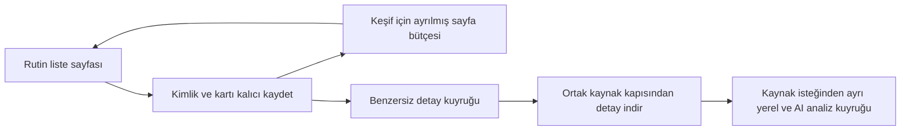

# İlan toplama hızı ve kayıt mimarisi incelemesi

İnceleme: 20 Ekim 2026. Kod ve üretim sürümü: `f3d6819`.
Saatler aksi belirtilmedikçe İstanbul, UTC+3. Üretim verisi değiştirilmeden incelendi.

**Güncelleme:** Önceki sürümün daha az 429 aldığı ayrıca karşılaştırıldı.
Aynı detay uç noktasında eski tamamlayıcı %4,75, son sürüm %13,33 429 almış.
Oturumun her işte yenilenmesi artık birinci inceleme/düzeltme önceliği.
Kanıtlar, belirsizlikler ve aşamalı doğrulama:
`429_ARTISI_ANALIZI_VE_PLAN_2026-10-20.md`.
Sonraki deneyler ve uygulama için esas alınacak ayrıntılı plan:
`DENEY_SONUCLARI_VE_AYRINTILI_PLAN_2026-10-20.md`.

## Sonuç

Yavaşlama gerçek; başlıca nedenleri **kaynağın koyduğu beklemeler, 10 saniyeden
120 saniyeye çıkan kalıcı istek aralığı ve rutin keşfin detay tamamlamaya sürekli
sıra bırakması**. Günlük toplamı ayrıca koleksiyonun hiç çalışmadığı uzun bir dönem
düşürüyor. Önceki hızlı ölçümler çoğunlukla kart keşfini ölçüyor; tüm detayların
aynı sürede hazır olduğunu göstermiyor.

Sistemin önce yanlış ilan üretip sürekli düzeltmesi ana neden olarak görünmüyor.
Kart kaydı → açıklamayı indirme → sınıflandırma, tasarlanmış iki aşamalı akış.
Buna karşılık gerçekten düzeltilmesi gereken kuyruk ve alarm hataları da bulundu.

## İncelemenin dayanağı

- Canlı `/healthz`: HTTP 200, veritabanı ve supervisor sağlıklı, sürüm `f3d6819`.
- GitHub commit, deploy, issue ve issue yorumları doğrudan okundu.
- `job_collector-backups` içindeki 16–20 Ekim SQLite yedekleri indirildi; yalnızca
  SQLite `mode=ro` ile açıldı. Son yedek 20 Ekim 03:34 UTC güncellemesinden.
- Son yedekte **1.322 ilan, 35.790 arama olayı, 1.261 uygulama logu, 219 tamamlama
  görevi** var. Arama olaylarının son zamanı **20 Ekim 06:10:03 İstanbul**.
- Yerel log anahtarı bulunmadığından GitHub secret'ını kullanan ayrı tanılama dalı
  hazırlandı ve mevcut iş akışı elle çalıştırıldı. [Canlı tanılama çalışması](https://github.com/tracecorp24/job_collector/actions/runs/39382262116).
- Ham veriler git dışında `.local/performance-audit-20261020/` altında.
  `snapshot-analysis.json`, `drilldown.json`, `selected-events.json`, `diagnosis.json`
  yeniden inceleme için saklandı. Anahtarlar rapora alınmadı.

Yedek, alındığı andaki durumu gösterir. Olay kayıtlarından hesaplanan eski dönem
ölçümleri, eksik eski olaylar yüzünden kesin toplam kapasite olarak yorumlanmamalı.
En güncel durum için canlı indirme dosyaları ve manifest esas alınmalı.

### Son canlı doğrulama: 20 Ekim 09:45 İstanbul

GitHub'daki mevcut secret kullanılarak sitenin **health, incidents, app log export,
arama olay export ve status uçlarının beşinden de HTTP 200** alındı. Yerel anahtar
eksikliği bu incelemenin güncel loglara erişmesini engellemedi. Tanılama branch'i
ana uygulama branch'inden ayrı; çalışan uygulama sürümü `f3d6819` kaldı.

- **36.024** arama olayı indirildi; son olay 09:18:25 İstanbul.
- Güncel kaynak durumu: **HTTP 429, 120 saniye etkili aralık, 6 ardışık ihlal,
  sorgu anında 277 saniye bekleme**. Supervisor canlı, uygulama hatası boş.
- Tamamlama kuyruğu: **223 done, 3 retry**; rutin kuyruğu bir çalışma bekliyor,
  **43 şehir takvimi zamanı gelmiş** durumda.
- 20 Ekim için canlı olaylarda **57 yeni ilan**, 18 liste / 83 detay isteği;
  **18 HTTP 429 ve 3 HTTP 403** var. Bunlar aşağıdaki yedek tablosundan daha sonraki
  sorgunun sayılarıdır.
- Log yazıcısında `dropped=0`, `spooled=0`, `last_error` boş. Bunlar mevcut süreç
  sayaçları; tüm geçmişte hiç kayıp olmadığını kanıtlamaz.
- Canlı incident hâlâ “4 ilanın detayı bekliyor; 60 saattir azalmadı” diyor;
  oysa son yedekten beri tamamlanan iş sayısı **210'dan 223'e yükselmiş**.
  Alarmın ilerlemeyi yanlış ölçtüğü güncel veriyle de doğrulandı.

Yanıtlar `live/manifest.json`, `live/status.json`, `live/events.jsonl`,
`live/app.jsonl`, `live/incidents.json`; özet `live/analysis.json` altında saklı.

## Gerçek hız: aynı ölçü birimini kullanmak gerekiyor

`jobs.created_at`, ilk kez veritabanına giren benzersiz ilanı ölçüyor. Detayı
sonradan tamamlamak veya aynı ilanı tekrar görmek bu sayıyı artırmıyor.

| Gün | İlk kez kaydedilen ilan | Liste isteği | Detay isteği | HTTP 429 | Kayıtlı kaynak beklemesi |
|---|---:|---:|---:|---:|---:|
| 17 Ekim | 132 | 83 | 118 | 36 | 10,82 saat |
| 18 Ekim | 600 | 183 | 428 | 39 | 5,63 saat |
| 19 Ekim | 159 | 31 | 377 | 25 | 6,33 saat |
| 20 Ekim, 06:10'a kadar | 50 | 17 | 63 | 12; ayrıca 2 HTTP 403 | 3,92 saat |

Beklemeler `source_paused` olaylarındaki zaman aralıklarının birleşimidir;
örtüşen bildirimler iki kez sayılmadı. Son aralık son arama olayında kesildi.
Tüm gün hiç ara vermeden çalışıldığı varsayılmadı.

18 Ekim'den 19 Ekim'e yeni ilan sayısı **%73,5 azalmış**. Ancak bu iki günün
arama kapsamı ve çalışma süresi farklı; farkın tümünü tek commit'e bağlamak yanlış.

Önceki hızlı örnek gerçekten var: `35065411840e47989e17f8adfb078e5e` koşusu,
18 Ekim **13:30–14:39** arasında 300 kayıt işlemiş; **293'ü yeni**, 7'si değişmeyen
ilan. Yaklaşık **255 yeni kart/saat**. Veritabanındaki en yoğun kayan 60 dakikada
**254 yeni ilan** var. Bu yedekler daha eski bir 300/saat ölçümünü dışlamaz.
Bu koşuda açıklamalar erteleniyordu; kart hızı, tamamlanmış detay hızı değildir.

Yeni İstanbul rutini 19 Ekim 14:44'te oluşmuş. Son yedek olayına kadar **15,42 saatte
209 yeni ilan** bulunmuş: ortalama **13,55 yeni ilan/saat**. Yaklaşık günlük 300
ilan gözlemiyle uyumlu büyüklükte; kesintisiz gelecek üretim tahmini değildir.

## Mimari ne zaman, nasıl değişti?

| Değişiklik | Etki |
|---|---|
| `e344660`, 17 Ekim: önce kart, detay sonra | Listeyi hızlı oluşturur; açıklama ve AI analizi sonraya kalır. |
| `cfe7328`: detay beklenirken AI çağırma | Boş açıklama için model kotası tüketilmez. |
| `ccb3409`: hafif misafir detay uç noktası | Yanıt boyutu ve HTTP süresi azalır; ortak kaynak beklemesi devam eder. |
| `b07f1dc` / `b82c1c3`: sayfa snapshot ve devam kaydı | Bekleme/kesinti sonrası aynı liste sayfasını tekrar indirme ihtiyacı azalır. |
| **`34bca7d`, 19 Ekim 12:04: manuel → tamamlama → rutin** | Eski, tarama boşken çalışan detay tamamlayıcının yerine supervisor'ın yönettiği kalıcı tamamlama kuyruğu gelir. Rutin, tamamlama işi çıkınca kesilebilir. |
| `3cc6389`: şehir × meslek rutini | 44 şehir, şehir başına 15 meslek; İstanbul'da meslek başına 150, diğerlerinde 50 üst sınırı. |
| **`f3d6819`, 19 Ekim 15:09: 60 saniye sessizlik** | Tamamlama/manüel işlerden sonra rutin için tekrar 60 saniye beklenir. |

GitHub'da son [deploy başarılı](https://github.com/tracecorp24/job_collector/actions/runs/39249956088).
Sorun, son kodun sunucuya gitmemiş olmasıyla açıklanmıyor.

### 1. Kaynak beklemesi ve kalıcı yavaş istek aralığı — doğrulandı

`jobapp/transport.py:151` ve `:161`:

- Her ihlalde ortak `interval_floor` 1,5 kat artıyor; üst sınır 120 saniye.
- Üçüncü ihlalden itibaren en az 900 saniye kaynak beklemesi uygulanıyor.
- Yeni ihlal gelmeden bir saat geçmedikçe başarılı yanıtlar aralığı azaltmıyor.
- Kararlı dönemde her başarıda yalnızca %5 azaltılıyor.

Canlı üretim olayları şu artışı gösteriyor: **15 → 22,5 → 33,75 → 50,625 →
75,9375 → 113,90625 → 120 saniye**. Son yedekte aralık **120**, ihlal serisi **6**.
İsteklere ayrıca %0–15 rastgele pay ekleniyor.

Bu, 10 saniyelik ayar var diye gerçekte 10 saniyede bir istek atılmadığı anlamına
geliyor. 120 saniyelik aralıkta ortalama teorik kapasite yaklaşık **28 istek/saat**;
her yeni ilan için bir detay ve bir miktar liste isteği gerektiğinde, blokaj olmadan
bile tamamlanmış ilan hızı yaklaşık **25/saat** düzeyinde kalabilir. Bu bir kapasite
hesabıdır; gerçek kaynak kapasitesi garantisi değildir.

İstanbul rutininin gözlenen 15,42 saatinin **9,42 saati, yaklaşık %61'i**, kayıtlı
kaynak blokajında geçmiş. Rutin başladıktan sonraki olaylarda yaklaşık **4,91 saat
ortak istek sırası beklemesi** ayrıca kayıtlı. Bu kategorilerden eksiksiz ve ayrık
bir zaman bütçesi çıkarmak için daha iyi süre ölçümü gerekiyor.

HTTP 429 hem eski hem yeni sürümde var. Yeni öncelik sistemi bu sorunu yaratmış
sayılmaz; fakat kaynak kotasının hangi işlere ayrıldığını değiştirmiştir.

### 2. Önce kart akışı detay önceliğiyle kesiliyor — doğrulandı

`jobapp/service.py:47`, `:130`, `jobapp/scheduling.py:48`:

1. Rutin bir liste sayfası indirir, kartları kaydeder.
2. `repair.discover` bunların eksik açıklamalarını tamamlama işi yapar.
3. Supervisor rutine `priority_yield` verir.
4. Tamamlama kuyruğu detayları indirir, sınıflandırır.
5. Yeni 60 saniyelik sessizlikten sonra rutin devam eder.

19 Ekim'de **26**, 20 Ekim'in ilk bölümünde **15** öncelik devri var.
19 Ekim kaynak isteklerinin **%92,4'ü detay**: 377/408. Bunun 203 isteği,
yeni rutin başlamadan önce eski bekleyen detaylara ait. Günlük oranı tek başına
yeni scheduler'ın etkisi diye sunmak doğru olmaz.

Yeni rutin başladıktan sonra da **48 liste / 237 detay** isteği görülüyor.
Sonuç: ilk kartlar hızlı görünse de sıradaki meslek/şehir keşfi detayların arkasında
bekliyor. Son yedekte İstanbul'un 15 sorgusundan 8'i bitmiş, biri duraklamış,
6'sı henüz sırada. Diğer şehirlere geçiş de bu kapsamda gecikiyor.

### 3. Çalışılmayan dönem günlük rakamı düşürüyor — doğrulandı

19 Ekim **03:38:39–14:44:50** arasında kaynak isteği yok: **11 saat 6 dakika**.
Yedekte `watches` tablosu boş; eski manuel aramalar bitmiş/durdurulmuş,
iki eski kuyruk taslak ve `service_managed` değil. Yeni şehir rutini öğleden
sonra devreye girmiş. Bu aralık için kaynak isteği yokluğu kesin; sırf bu boşluktan
servisin kapalı olduğu sonucu çıkmaz.

### 4. Arama kapsamı ve yinelenen ilanlar hız algısını değiştiriyor

Eski hızlı örnek Karlsruhe'de çeşitli yönetim pozisyonları; yeni rutin İstanbul'da
son 7 günle sınırlı, en yeniden sıralı mühendislik araması. Aynı havuz ve aynı
yenilik oranı değiller. Örneğin yeni rutindeki Bilgisayar Mühendisliği sayfası
10 kartın tamamını bilinen bulmuş; Makine Mühendisliği sayfasında yalnızca bir
yeni ilan görülmüş. Erken durma bu durumda kaynak tüketimini azaltıyor.

44 × 15 = **660 sorgu** var. Tüm limitler dolarsa **34.500 kartlık** teorik günlük
kapsam oluşuyor. Limitler doldurulma garantisi değildir. Bütün kartlar yeni olsa
mevcut tek kaynak kapasitesiyle hepsinin detaylarını aynı gün tamamlama beklentisi
gerçekçi değil. Şehir adaleti ve meslek başına sayfa bütçesi gerekiyor.

## Önce hatalı çekip sonra mı düzeltiyor?

Genel akışta **eksik açıklamayı sonradan tamamlıyor**. Bu, yanlış başlık/şirket
üretip tekrar tekrar düzeltmekle aynı şey değil.

- Son yedekte 1.322 kaydın tamamı `quality_ok=1`; bu, semantik doğruluğun eksiksiz
  doğrulandığını değil, mevcut kalite kapısından geçtiğini gösterir.
- 219 tamamlama işinin **210'u done, 7'si pending, 2'si retry**. Tamamında başarısız
  alan deneme sayısı **0**. İki retry, HTTP 429 nedeniyle kaynak bekliyor.
- `attempts=0`, ağ isteği yapılmadı demek değildir: kaynak duraklatması bilerek
  başarısız alan denemesi sayılmıyor.
- Güncel retry işlerinde aynı ilana birden çok 429/403 isteği görülebiliyor.
  Alan denemesi sayacına ek olarak toplam ağ denemesi, erişim reddi sayısı ve
  ilk beklemeye giriş zamanı ayrı izlenmeli. Mevcut kod kaynak duraklatmaları
  için terminal deneme sınırı uygulamıyor; bu gelecekte uzun tekrar zincirleri
  yaratabilir. Bu, başarılı bir açıklamanın tekrar tekrar yanlış ayrıştırıldığı
  anlamına gelmez.
- 210 detay indirme → tamamlama eşleşmesinde medyan süre **3,70 saniye**,
  en yüksek **6,78 saniye**. Açıklama geldikten sonraki işleme günler sürmüyor.
- İncelenen kayıtların tamamında sadece **10 ek başarılı detay isteği** aynı URL'yi
  yeniden indirmiş. Bunun her biri gereksiz demek değil; farklı tarih/yenileme
  bağlamları var. Kitlesel başarılı indirme → tekrar düzeltme döngüsü kanıtı yok.

**Gerçek kuyruk tutarsızlığı:** `external_id=4479822205`, yerel ilan `#1212`,
açıklaması 2.204 karakter olduğu halde `detail_pending=1`; tamamlama işi `done`.
`repair.discover` mevcut bir tamamlama satırı varsa yeniden kuyruğa almıyor,
`enqueue` normalde conflict durumunda hiçbir şey yapmıyor. Yeni kart revizyonu
yeniden bekleyen duruma geçtiğinde tamamlanmış görev yeniden açılmayabiliyor.
Bu tek kayıt genel hız düşüşünü açıklamaz, fakat kuyruk doğruluğunu bozar.

`Details.known()` açıklaması olmayan mevcut kartları bilinen saymıyor. Keşfedilmiş
ilan ile detayları tamamlanmış ilan kavramları ayrılmadığından düşük yenilik
hesabını ve gelecekteki yeniden keşifleri etkileyebilir.

## Loglama yeterli mi?

**Ham olayları sonradan incelemek için güçlü, performans kararı vermek için eksik;
bir alarmı da yanlış sonuç üretiyor.**

İyi taraflar: kalıcı `search_events` ve `app_logs`, istek kimliği, HTTP durumu,
yanıt süresi/boyutu, arama kimliği, snapshot/devam kaydı, 90 günlük saklama,
anahtar maskeleme, toplu log yazımı, DB yazılamazsa spool, kalıcı incident geçmişi,
GitHub eşitlemesi ve deploy sürümü var.

### Hatalı “detaylar X saattir azalmadı” alarmı

`jobapp/problems.py:69` yalnızca `count < saved['min']` olursa süreyi yeniliyor.
Üretimdeki ayar **`min=0, since=2026-10-17 18:09:34 UTC`** olarak kalmış.
Sayı sıfıra indikten sonra yeni işler gelse ve tek tek tamamlansa da sıfırdan daha
aza inemiyor. Böylece yeni ve sağlıklı bir kuyruk için eski başlangıçtan itibaren
“25/50/57 saattir azalmadı” mesajları üretilebiliyor.

[Issue #4](https://github.com/tracecorp24/job_collector/issues/4) içindeki **239
ilan / 25 saat** metni gerçek bir alarm kaydı; fakat süre iddiası güvenilir değil.
İlk alarm **18 Ekim 18:09:47 UTC**; uygulama loglarında **18:09:00, 18:11:10,
18:13:19** anlarında başarılı detay tamamlama var. İlerleme sürerken tıkanma alarmı
üretilmiş. Çözüm: toplam sayının tarihi minimumu yerine son başarılı tamamlama,
en eski hazır işin yaşı ve giriş/çıkış sayıları izlenmeli; boş kuyruk yeni dönem
başlangıcını sıfırlamalı.

### Diğer görünürlük eksikleri

- Tamamlama worker'ında `process_raw(..., emit=...)` kullanılmıyor. Bu yüzden
  detay sonrası AI çağrıları `processing_stage` sürelerinde görünmüyor.
  Havuzda **186 Groq kaydı** varken sınıflandırma aşaması loglarında Groq ile
  tamamlanmış çağrı görünmemesi bunun somut işareti. Görünen toplam sınıflandırma
  süresini tüm AI maliyeti diye kullanmak yanlış.
- `repair_retry` SSE'ye gönderiliyor; tüm retry nedenleri, stage başlangıç/bitişi,
  model fallback ve token kullanımı kalıcı arama olaylarına eksiksiz aktarılmıyor.
- `frozen_ratio`, detay tamamlayıcının beklemelerini dışarıda bırakıyor. Rutin
  keşif ve tamamlanmış ilan gecikmesini açıklayan sistem metriği değil.
- Görev `stats` alanındaki bazı değerler son denemeye ait. Örneğin kümülatif
  `savedCount=111` yanında son boş sayfanın `totalCardsSeen=0` değeri bulunabiliyor.
  “Son deneme” ve “tüm koşu” sayaçları açıkça ayrılmalı.
- App logunda sürüm var; her `search_events` satırında açık deploy sürümü yok.
  Sürüm karşılaştırması için deploy zamanlarıyla eşleştirme gerekiyor.
- `/healthz=ok` sadece servis/supervisor sağlığını anlatıyor. Saatte yeni ilan
  üretilmese de sağlıklı dönebilir.
- GitHub cron'unda 30 dakika tanımlı olması, kayıtların gerçekten o sıklıkla
  eşitlendiğini garanti etmiyor; son Actions çalışmaları arasında saatler var.
- [Issue #2](https://github.com/tracecorp24/job_collector/issues/2) birkaç kez
  otomatik kapanıp yeniden açılmış. “30 dakika koşul yok” yorumu kalıcı performans
  iyileşmesi kanıtı olarak okunmamalı.

## Önce isimleri, sonra detayları toplamak nasıl olmalı?

Bu özellik zaten açık; sorun işlerin hangi sırada ve ne kadar süre çalıştırıldığı.
Yalnızca isim yerine **kaynak ilan kimliği + URL + başlık + şirket + konum +
yayın zamanı + ilk görülme zamanı** birlikte kaydedilmeli. İsim tekilleştirme için
yetersiz; iki ayrı ilanın adı aynı olabilir.

Önerilen akış:



1. Manuel önceliği koruyarak rutin keşfe her tur garanti edilen bir pay verilmeli.
   Örneğin ilk taramada şehir/mesleklerin ilk sayfalarını dolaşan sınırlı keşif turu;
   sonra bir detay bütçesi. Tamamlama işleri her yeni sayfada bütün rutini kesmemeli.
2. Normal, ilk kez detay bekleyen ilanlar ayrı tutulmalı; gerçekten hatalı eski
   kayıtların onarımı sınırsız yüksek öncelik almamalı. Yaşa ve iş sayısına göre
   denge kurulmalı; tüm detayları sonsuza kadar ertelemek de doğru değil.
3. 60 saniyelik sessizlik manuel etkinlikten rutine geçişte uygulanmalı;
   rutinin kendi ürettiği her detay grubundan sonra baştan başlaması gerekmiyor.
4. Başlık/kart kaydı, açıklaması hazır ve AI analizi hazır durumları ayrı ölçülmeli.
   Panelde “yeni kart/saat”, “ilk detay tamamlandı/saat”, en eski bekleyen detay ve
   p50/p95 detay gecikmesi görünmeli.
5. Kaynağa giden tüm istekler mevcut tek koordinatör ve Retry-After politikasından
   geçmeli. Yalnızca kartlara daha fazla pay vermek detayları tamamlamanın toplam
   ağ isteği ihtiyacını ortadan kaldırmaz.
6. AI zenginleştirme ağ keşfini bekletmeyen ayrı, kalıcı bir aşama olmalı; değişmeyen
   başlık/açıklama için içerik hash'i ve sınıflandırıcı sürümüyle yeniden kullanım
   sağlanmalı. İlk kartta AI'nın ertelenmesi mevcut kodda zaten uygulanmış.

Mevcut 120 saniyelik aralıkta tamamen listeye ayrılan teorik kapasite, sayfa başına
10 kart varsayımıyla yaklaşık 280 kart/saat olabilir. Bunların tümü yeni olmayabilir;
detaylar aynı kaynak bütçesini kullanır. Bu hesap, kart keşfinin neden tam ilan
tamamlamadan çok hızlı görünebildiğini açıklıyor; üretim taahhüdü değildir.

## Düzeltme sırası

| Sıra | İş | Başarı ölçütü |
|---|---|---|
| 0 | Oturum kimliği, iş/istek numarası, uç noktası ve deploy sürümünü kalıcı olaylara ekle | Oturum parçalanması ve sürüm etkisi ölçülür; çerez/anahtar içeriği kaydedilmez. |
| 1 | Eski tamamlayıcıdaki sürekli HTTP istemcisi yaşam süresini geri kazan | Normal ardışık detay işlerinde aynı oturum kullanılır; 429/403 ve verim mevcut politika altında karşılaştırılır. |
| 2 | Yalnız oturum değişikliğini doğal kuyrukta kontrollü gözle | Endpoint bazında yeterli örnek ve 24 saat gözlem; sonraki kuyruk/pacing değişiklikleriyle nedenler karıştırılmaz. |
| 3 | Yinelenen kaynak reddine ilan bazlı ağ sayacı ve ek bekleme ekle | Kaynak genelindeki beklemeye uyarak aynı sorunlu işin sürekli geri gelmesi önlenir. |
| 4 | Rutin keşfe sınırlı ama garanti edilen pay ver; kendi detaylarından sonra 60 saniyeyi tekrar başlatma | Kaynak açıkken rutin ilerler; manuel öncelik korunur. |
| 5 | Backlog alarmını ve `done` görev + yeni `detail_pending` revizyonunu uzlaştır | İlerleme varken yanlış alarm çıkmaz; ilan #1212 benzeri sahipsiz kayıt kalmaz. |
| 6 | Oturum ve kuyruk düzeltmeleri ölçüldükten sonra aralık toparlanmasını değerlendir | Kaynak beklemesine uyularak gerçek 429/403 ve başarılı detay/saat sonuçları esas alınır. |
| İzleme | Tamamlama süre/model/sonuç kaydı ve sistem genelinde hız raporu | Kaynak, kuyruk ve AI süreleri; kart hızı ve detay hazır olma hızı ayrı izlenir. |
| Devam | Şehir ve meslekler arasında sayfa bütçesi / adalet | İlk İstanbul turu bitmeden diğer şehirler sınırsız beklemez. |

Sıralama, 429'a hangi değişikliğin etki ettiğini ayırmak içindir. Alarm ve revizyon
uzlaştırmasının ağ davranışını değiştirmeyen kısımları ayrı hazırlanabilir.

Eski detay tamamlayıcı oturumu yeniden kullanıyordu; yeni `repair.worker` her detay
işinde yeni scraper açıp kapatıyor. Ek incelemede eski 631 detay isteğinde ilk
istek sayacı 4 kez, yeni 257 detay isteğinde 257 kez görülmüş. Aynı uçta 429 artışı
da doğrulanmış. Bu nedenle oturum sürekliliği artık ilk sırada; kaynak engeline
nedensel etkisinin büyüklüğü kontrollü gözlemle doğrulanmalı.

Hız bekleme politikasını sıfırlayarak artırılmamalı. 10 saniyenin “sıfır 429 garanti
eden güvenli tavan” olduğu eski rapor iddiası üretim kayıtlarıyla desteklenmiyor.
Küçük canlı deneyler IP başına sürekli kapasite veya WAF algoritması ispatı değil.

## Yeniden üretme ve teslim

Uygulama davranışı, kaynak politikası ve üretim veritabanı bu inceleme kapsamında
değiştirilmedi. Analiz aracı eklendi ve gerçek yedekte çalıştırıldı:

```powershell
python scripts/collection_diagnosis.py --db .local/performance-audit-20261020/jobs-20261020.db --output .local/performance-audit-20261020/diagnosis.json
```

Bu araç Python standart kütüphanesini kullanır; uygulamayı başlatmaz, göç çalıştırmaz,
ağ isteği yapmaz. Yeni anahtar üretip sunucu ayarını değiştirmek yerine mevcut GitHub
secret'ıyla log protokolü kullanıldı. Tanılama dalı:
`audit/live-collection-diagnosis-20261020`; çalışma commit'i `d5025eb`.

Sonraki ajan için kısa başlangıç: `AI_CALISMA_BAGLAMI.md`.
